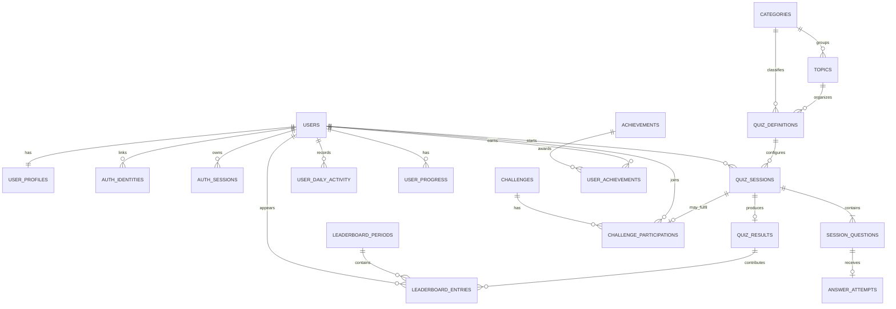

# Daily Quiz & Challenge V2 — Proposed Database Architecture

**Status:** Phase 1 proposal for review — not implemented  
**Target platform:** Cloudflare D1 (SQLite)  
**Working branch:** `feature/v2-database-architecture`  
**Scope:** Documentation and design only

> This document is a proposed logical and initial physical data model for V2. It does not create a D1 database, binding, migration, Worker route, authentication service, or production data. Table names and fields are recommendations for review, not approved implementation details.

## 1. Design goals and boundaries

The database should support a global quiz and learning product while keeping the existing V1 application and its production Worker routes stable.

The design aims to:

- Keep account identity, profile, authentication credentials and sessions distinct.
- Make the server authoritative for quiz sessions, accepted answers, scores and competitive results.
- Preserve the exact question content and answer key used in a session so results remain auditable if a provider later changes its question.
- Keep provider/source provenance for questions and content.
- Support challenges, personal progress, achievements and non-cash leaderboards.
- Avoid storing redundant data until a demonstrated query or performance need justifies it.
- Support account deletion, retention controls and privacy-by-design.
- Use ordinary relational constraints and indexes that are compatible with SQLite/D1.

### Explicit non-goals

This proposal does not:

- Configure or create Cloudflare D1.
- Configure KV or R2.
- Change the current V1 Worker, routes, providers, application, AdMob or signing identity.
- Implement authentication or Google sign-in.
- Decide final API routes or request/response payloads.
- Implement cash-prize competitions, payments or purchases.
- Claim that any V2 table or service currently exists.

## 2. Recommended persistence approach

**Recommendation: use D1 as the primary relational store, subject to a short validation before implementation.**

Accounts, linked identities, sessions, quiz attempts, results, challenge participation and progress have structured relationships and need reliable constraints. D1 is a plausible fit for these records.

Before implementation, verify current Cloudflare plan limits, D1 database/row/storage limits, transaction behavior, query/index constraints, backup/export and restore procedures, migration workflow, operational observability, data residency/privacy requirements and expected usage. Confirm that the required transaction patterns fit the current D1 platform.

Do not introduce additional storage products without a concrete need:

- **D1:** primary relational records and authoritative result ledger.
- **KV:** optional for suitable cache, short-lived lookup or rate-limit use cases only after consistency and expiry behavior are assessed. It is not the source of truth for scores.
- **R2:** optional for larger files/assets, not transactional quiz answers or scores.

Use separate development/staging/production resources and credentials. Never point a test build at production user data.

## 3. Logical entity relationship diagram

The diagram is intentionally a first-pass logical model. It shows the main entities and cardinalities; it is not a migration script.

A leaderboard entry is shown as an optional materialized snapshot for a defined period. The initial implementation may instead calculate rankings from authoritative results using indexed queries. Do not maintain both approaches until there is a measured performance requirement and a reconciliation strategy.

## 4. Proposed tables and responsibilities

The following is the recommended starting model. Exact column types, constraints and indexes must be finalized against the selected API and product rules before writing migrations.

### 4.1 Accounts and authentication

| Table | Purpose | Important fields / rules |
|---|---|---|
| `users` | Canonical account record | `id` (opaque UUID/ULID text primary key), `email_normalized` (nullable until verified/available), `email_verified_at`, `status`, `created_at`, `updated_at`, `deleted_at`. Unique normalized email where non-null. |
| `user_profiles` | Public/display profile and preferences | `user_id` primary key/FK, `display_name`, `avatar_asset_key` (optional), `country_code` (optional), `timezone`, `locale`, `created_at`, `updated_at`. Avoid collecting unnecessary personal details. |
| `auth_identities` | One or more sign-in methods linked to a user | `id`, `user_id`, `provider` (`password` or `google` initially), `provider_subject` (Google subject for Google; stable internal value for password identity), `password_hash` (only for password identity), `created_at`, `last_used_at`. Unique (`provider`, `provider_subject`). |
| `auth_sessions` | Revocable server-managed sessions | `id`, `user_id`, `refresh_token_hash` or equivalent protected token identifier, `created_at`, `expires_at`, `revoked_at`, `last_used_at`, optional device/session label. Never store raw bearer/refresh tokens. |
| `email_verification_tokens` | Short-lived email verification state, if email verification is required | Store only a cryptographic token hash, user reference, expiry, consumed timestamp and creation timestamp. |
| `password_reset_tokens` | Short-lived password recovery state | Store only a cryptographic token hash, user reference, expiry, consumed timestamp and creation timestamp. |

**Authentication notes**

- Google identity tokens must be verified by the trusted Worker using Google's supported verification process, including signature, issuer, audience and expiry checks. The client must not be able to create a trusted identity by submitting an email address alone.
- A Google identity is keyed by its stable provider subject, not by a mutable email address.
- Account linking must require proof of control of the existing account and the new identity. Do not silently merge accounts just because two providers return the same email.
- Passwords must be processed using a vetted password-hashing implementation suitable for the Workers runtime. Store only the resulting password hash and required parameters; never plaintext or reversibly encrypted passwords.
- Session tokens must be high entropy, expiring and revocable. Store only protected token representations server-side. Rotate refresh credentials and revoke prior credentials on rotation/reuse detection as appropriate.
- Add rate limits and generic recovery responses to reduce brute-force and account-enumeration risks.
- The exact token format, password-hashing library, email delivery provider and verification policy remain decisions for the authentication design task.

### 4.2 Quiz catalog and source provenance

| Table | Purpose | Important fields / rules |
|---|---|---|
| `categories` | Top-level quiz categories | `id`, `slug` (unique), `name`, `description`, `sort_order`, `is_active`. |
| `topics` | Optional subcategories/topics | `id`, `category_id` FK, `slug`, `name`, `sort_order`, `is_active`. Unique (`category_id`, `slug`). |
| `quiz_definitions` | Reusable quiz configuration/catalog entry | `id`, `category_id` FK, nullable `topic_id` FK, `title`, `difficulty`, `question_count`, `time_limit_seconds`, `is_active`, timestamps. |
| `question_sources` | Provider/source registry | `id`, `source_key` (unique), `display_name`, `source_type`, `attribution_text`, `terms_url` (where applicable), `is_active`. |

V2 should preserve the existing content/provider boundaries. Current Affairs remains a fact-first verified knowledge system; News Quiz/Current Events remains a separate news-provider system. Do not make NewsData the Current Affairs source. Source/provider credentials remain in Cloudflare secrets, never in database rows or the Android app.

The session snapshot described below is required even if a separate normalized question bank is introduced later. A canonical `questions` table and a richer fact/source registry may be added if V2 needs persistent curated content, editorial review, versioning or cross-session analytics. Do not assume all external-provider questions should be permanently copied into a global question bank without reviewing provider terms and attribution obligations.

### 4.3 Quiz sessions, question snapshots, attempts and results

| Table | Purpose | Important fields / rules |
|---|---|---|
| `quiz_sessions` | Server-created bounded quiz instance | `id`, `user_id` FK, `quiz_definition_id` nullable FK, `status`, `started_at`, `expires_at`, `completed_at`, `scoring_version`, `question_count`, `client_request_id` (idempotency key), timestamps. |
| `session_questions` | Immutable snapshot of each delivered question | `id`, `quiz_session_id` FK, `position`, `source_id` nullable FK, `source_question_ref` nullable, `prompt`, `options_json`, `correct_answer_key`, `explanation` nullable, `content_version` nullable, `delivered_at`, `deadline_at`, `answered_at`, `status`. Unique (`quiz_session_id`, `position`). |
| `answer_attempts` | Accepted answer submission/audit record | `id`, `session_question_id` unique FK, `user_id` FK, `selected_answer_key`, `is_correct`, `points_awarded`, `received_at`, `response_time_ms`, `idempotency_key` unique. |
| `quiz_results` | Final authoritative session outcome | `id`, `quiz_session_id` unique FK, `user_id` FK, `score`, `correct_count`, `incorrect_count`, `unanswered_count`, `duration_ms`, `scoring_version`, `finalized_at`. |

**Critical security boundary:** `correct_answer_key` is server-side data. It must never appear in the API response that delivers a question to the Android client. The client submits a selected option; the Worker evaluates it, awards points and persists the result. Do not trust client-submitted totals, correctness flags, elapsed time, user IDs or ranking values.

Recommended initial rules:

- A session belongs to exactly one authenticated user and has a server-generated expiry.
- A session has a bounded number of questions and a defined scoring version.
- The Worker records the exact prompt/options/answer key snapshot used for the session. This protects auditability when provider content changes later.
- A session question accepts at most one final answer in the initial model. A retry with the same idempotency key returns the original outcome; a conflicting duplicate is rejected. If product design later allows answer changes, model each submission as an append-only attempt and define which attempt counts before implementation.
- Validate that the session is active, unexpired, owned by the authenticated user, and that the question belongs to it and has not already been answered.
- Apply timing rules on the server. Client clocks are not authoritative.
- Finalize the result once. Use a transaction or equivalent safe write sequence so attempts, result and completion state cannot disagree.
- Abandoned, expired, timed-out and disconnected sessions need explicit state-transition rules in the quiz-session design.
- Keep a scoring version with the result so future scoring changes do not rewrite historical outcomes.

### 4.4 Challenges, activity and progress

| Table | Purpose | Important fields / rules |
|---|---|---|
| `challenges` | Daily, weekly or special challenge definition | `id`, `slug`, `title`, `description`, `challenge_type`, `starts_at`, `ends_at`, `rules_json`, `is_active`, timestamps. |
| `challenge_participations` | A user's participation in a challenge | `id`, `challenge_id` FK, `user_id` FK, nullable `quiz_session_id` FK, nullable `quiz_result_id` FK, `status`, `joined_at`, `completed_at`. Add uniqueness according to whether one or multiple attempts are allowed. |
| `user_daily_activity` | Per-user daily activity facts | `user_id` FK, `activity_date` (date in the user's agreed timezone policy), `completed_quizzes`, `questions_answered`, `correct_answers`, `points_earned`, `updated_at`. Composite primary key (`user_id`, `activity_date`). |
| `user_progress` | Optional compact progress summary for fast profile reads | `user_id` primary key/FK, `total_quizzes`, `total_questions`, `total_correct`, `current_streak`, `best_streak`, `last_activity_date`, `updated_at`. Values must be derived/updated from authoritative records, never accepted from the client. |

Daily activity is the dated source record for streak calculation. Define the timezone policy before implementation: use the profile timezone captured under a documented rule, and ensure a user's timezone change does not silently rewrite past activity dates. The progress summary is a cache/aggregate and should be rebuildable from authoritative quiz results and daily activity. If it cannot be rebuilt, it must not be treated as the sole source of truth.

### 4.5 Achievements and rankings

| Table | Purpose | Important fields / rules |
|---|---|---|
| `achievements` | Achievement catalog and criteria metadata | `id`, `code` (unique), `name`, `description`, `criteria_json`, `is_active`. |
| `user_achievements` | Achievement awards to users | `user_id` FK, `achievement_id` FK, `awarded_at`, optional `source_result_id` FK. Composite primary key (`user_id`, `achievement_id`). |
| `leaderboard_periods` | Optional named ranking windows | `id`, `period_type`, `starts_at`, `ends_at`, `status`. |
| `leaderboard_entries` | Optional materialized ranking snapshot | `id`, `period_id` FK, `user_id` FK, `score_total`, `rank_position`, `calculated_at`, optional source/result reference. Unique (`period_id`, `user_id`). |

For the first release, prefer calculating non-cash leaderboards from eligible authoritative `quiz_results` and challenge rules, using appropriate indexes and clearly defined time windows. Add snapshot entries only if query cost or latency justifies them. A snapshot must be reproducible and traceable to source results. Define tie-breaking, eligibility, timezone/window boundaries, disqualification and recalculation rules before implementation.

No cash-prize, redeemable-value or paid-entry competition is included in this design. Such a feature would require a separate security, fraud, legal, payment and operational review.

## 5. Key relationships and integrity rules

- One user has one profile, multiple linked authentication identities and multiple sessions.
- One user can start many quiz sessions; a quiz session belongs to one user.
- One quiz session contains an ordered set of session-question snapshots.
- Each session question has at most one accepted final answer in the initial design.
- A completed quiz session produces at most one authoritative result.
- A challenge can have many participants; participation is tied to a user and may reference the quiz session/result that fulfilled it.
- Daily activity is unique per user and activity date.
- An achievement can be awarded to a user only once unless a future repeatable-award model is explicitly designed.
- Leaderboard records must be derived from authoritative results and server-defined eligibility rules.
- Use foreign keys, unique constraints, check constraints and explicit state transitions wherever supported and tested in D1/SQLite.
- Use UTC timestamps for instants; store local date/timezone context separately where calendar-day rules require it.
- Use opaque, non-sequential identifiers for public-facing IDs. Do not expose internal database row IDs unnecessarily.

## 6. Initial index and uniqueness plan

The final indexes should be validated with representative queries and D1 query plans. Likely starting candidates:

| Table | Candidate index / constraint | Why |
|---|---|---|
| `users` | Unique index on `email_normalized` where not null | Prevent duplicate email accounts while allowing accounts without an email value if product policy permits. |
| `auth_identities` | Unique (`provider`, `provider_subject`); index (`user_id`) | Prevent identity duplication and list linked methods. |
| `auth_sessions` | Index (`user_id`, `expires_at`); unique token-hash identifier | Session lookup, expiry and revocation. |
| `quiz_sessions` | Index (`user_id`, `started_at`); index (`status`, `expires_at`) | User history and expiry cleanup. |
| `session_questions` | Unique (`quiz_session_id`, `position`) | Stable question order and no duplicate positions. |
| `answer_attempts` | Unique (`session_question_id`); unique `idempotency_key`; index (`user_id`, `received_at`) | One accepted answer per question, retry safety and audit/history. |
| `quiz_results` | Unique (`quiz_session_id`); index (`user_id`, `finalized_at`); index (`finalized_at`, `score`) | One final result per session, profile history and leaderboard queries. |
| `topics` | Unique (`category_id`, `slug`) | Prevent duplicate topic slugs within a category. |
| `challenge_participations` | Index (`challenge_id`, `status`); index (`user_id`, `joined_at`) | Challenge participant lists and user history. |
| `user_daily_activity` | Composite primary key (`user_id`, `activity_date`) | Daily aggregation and streak calculation. |
| `user_achievements` | Composite primary key (`user_id`, `achievement_id`) | Prevent duplicate awards. |
| `leaderboard_entries` | Unique (`period_id`, `user_id`); index (`period_id`, `rank_position`) | Period ranking reads, if snapshots are adopted. |

Avoid adding indexes speculatively to every field: they increase write cost and storage. Confirm query patterns first.

## 7. Privacy, security and lifecycle

- Collect the minimum account/profile data needed for product functionality.
- Do not store passwords, raw verification tokens, raw refresh tokens or provider client secrets.
- Do not store Google ID tokens as long-lived credentials. Verify the assertion and issue the application's own session.
- Keep answer keys and trusted scoring inputs on the server. Ensure logs and analytics never include answer keys or session tokens.
- Enforce authorization in Worker code for every user-owned record. A client-supplied user ID is not proof of ownership.
- Use parameterized SQL statements and strict request validation.
- Apply rate limits to authentication, recovery, session creation and answer submission.
- Define account deletion/anonymization behavior across profiles, identities, sessions, results, challenge records and leaderboard history. Retention of anti-fraud/audit records, if needed, must be justified, disclosed and time-limited.
- Define data export, correction, retention and backup/restore procedures before launch.
- Do not log unnecessary personal data. Set retention periods for operational logs and security events.
- Keep environment-specific D1 IDs, secrets and credentials out of source control.

## 8. Data lifecycle and consistency

The Worker should own all writes to protected V2 tables. The Android app reads permitted data through authenticated API endpoints and submits user actions; it does not connect directly to D1.

For quiz completion, design the write path so the answer attempt, session-question state, quiz result and session completion cannot be partially applied. Use D1 transactions where supported for the selected execution model, or a carefully designed idempotent sequence with reconciliation if a single transaction is not suitable.

Derived values such as streaks, totals, achievements and leaderboard snapshots must be reproducible from authoritative source records. Document repair/recalculation jobs and audit behavior before production.

Use schema migrations checked into the repository when implementation begins. Each migration should be ordered, reviewed, tested against a disposable development database and have a rollback/recovery plan. Never test destructive migrations against production.

## 9. Open decisions for the next Phase 1 design tasks

These items are deliberately not decided in this document:

1. Whether guest users can complete quizzes and, if so, which records remain local versus server-side.
2. Whether email verification is mandatory before quiz-result synchronization or only before selected account actions.
3. Exact password-hashing implementation and Google token verification library/process for Cloudflare Workers.
4. Access/refresh token format, expiry, rotation and revocation policy.
5. Whether quiz questions are persisted in a canonical V2 content bank or only snapshotted per session for the initial release.
6. Whether one quiz session allows one answer per question or supports changing/revising an answer.
7. Exact scoring formula, timeout rules, tie-breakers and treatment of abandoned sessions.
8. Whether challenge participation permits one attempt or multiple attempts.
9. Whether leaderboards are calculated on demand initially or materialized by scheduled jobs.
10. Timezone policy for daily challenges, activity dates and streaks.
11. Data retention, account deletion/anonymization and export policy.
12. Expected user volume and query patterns needed to validate D1 limits, indexes and cost.
13. Whether any additional audit/event table is required after the threat model and API contract are defined.

## 10. Review checklist and acceptance criteria

This proposal is ready for review when we can answer:

- Does the model cover the account, profile and sign-in methods we intend to support?
- Does it prevent client-side answer keys and scores from becoming authoritative?
- Can we reconstruct exactly which questions and answer options were delivered in a completed session?
- Are duplicate submissions and retries safe?
- Can we support the five-tab product experience, personal history, challenges, progress, achievements and non-cash rankings?
- Are current V1 provider and category boundaries preserved?
- Are privacy, deletion, retention and account ownership addressed?
- Have we validated D1 limits, transactions, migration and recovery requirements before implementation?
- Are all unresolved decisions visible rather than silently assumed?

**Phase 1 status:** proposed database model and ERD drafted; awaiting joint review. No database infrastructure or application code has been changed.
